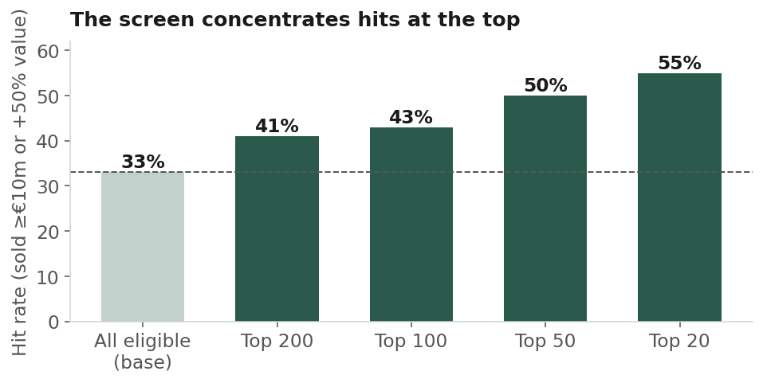
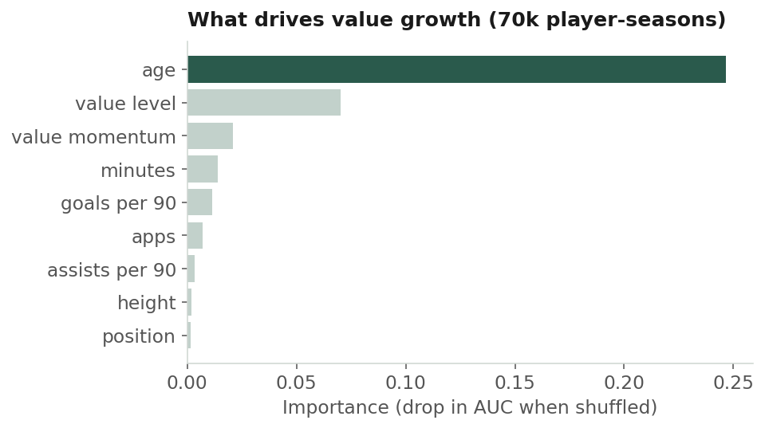

# Can open data spot the next €30m player?

An open-data scouting pipeline that looks for **undervalued, misprofiled and underused young
players** across the ten strongest leagues in world football, then back-tests whether its picks
actually paid off.

**[Read the write-up →](https://emcgleenan23.github.io/open-source-football-exploration/)**

| | |
|---|---|
| **Screen** | Top-20 picks hit at **55%** vs a 33% base rate (1.66× lift) in a strict point-in-time back-test |
| **Value model** | Gradient boosting on ~70,000 player-seasons (2012–2025): out-of-time **ROC-AUC 0.81**, **3.1×** top-decile lift |
| **Data** | Free only: FBref per-90 stats (~6,700 players) and a Transfermarkt-derived Kaggle dataset |

A "hit" is a player sold for ≥€10m or whose market value rose ≥50% in the year after the cutoff.



## How it works

**1. The screen**, `src/run.py`, scores every eligible player on four signals, always within
their positional peer group so a full-back is never measured against a striker:

| Signal | What it captures |
|---|---|
| Performance | Attacking output and creation per 90 (shots, key passes, shot- and goal-creating actions) |
| Intensity | Pressing, tackling, carrying and recovery volume: an open-data proxy for physical capacity |
| Misprofiling | A linear discriminant role model flags players whose statistical fingerprint fits a different role from their listed position |
| Underused | Strong per-90 output on a low share of team minutes |

An eligibility gate (minutes, age, market value) runs first; the weighted composite is
`scout_score`. Weights, filters, leagues and peer groups all live in `config.yaml`.

**2. The back-test**, `src/backtest.py`, freezes everything knowable in June 2025 (stats, market
value as of that date, position), ranks players, then measures outcomes strictly after the cutoff.
No lookahead.

**3. The determinant model**, `src/value_model.py`, asks the data directly what predicts a ≥50%
value rise, training on early seasons and testing on recent ones. Age dominates, followed by
current value level, momentum, minutes and goals, which is consistent with the player-valuation
literature.



**4. The forward run**, `src/forward.py`, applies the same point-in-time scoring to 2025/26 to
name the players who fit last year's breakout profile.

The literature behind each signal (Bergkamp et al., 2022; Barraclough et al., 2025; Poli, Besson
& Ravenel, 2022; Franceschi et al., 2023) is mapped out in [`docs/methodology.md`](docs/methodology.md).

## Run it

```bash
python -m venv .venv && source .venv/bin/activate
pip install -r requirements.txt

python -m src.pull_data_selenium   # FBref player tables -> data/raw/  (or pull_data_http)
python -m src.run                  # screen -> data/processed/shortlist.csv
python -m src.backtest             # point-in-time back-test
python -m src.value_model          # multi-season determinant model
python -m src.forward              # 2025/26 forward run

pytest -q                          # offline tests on synthetic data
```

Market values, ages, positions and transfers come from the Kaggle dataset
[`davidcariboo/player-scores`](https://www.kaggle.com/datasets/davidcariboo/player-scores).
Download its CSVs into `data/`. Transfermarkt itself is never scraped. Players are joined by
accent-folded name with club as tie-breaker, and unmatched players are kept rather than dropped.

No data is committed: `data/` is git-ignored.

### A note on FBref in 2026

Opta withdrew its advanced statistics from FBref in 2026. The analysis here uses tables pulled
before that change. Re-running the pull today returns only basic stats (minutes, goals, assists,
cards), which is enough for the value model but not for the intensity or misprofiling signals.
Swapping in another event-data source (StatsBomb open data, for example) is the natural route to
restoring them.

The pull scripts (`pull_data_selenium`, `pull_data_http`, and the original `soccerdata` path in
`pull_data`) are kept for reference, along with `diagnose_fetch` for checking whether FBref is
rate-limiting you.

## Limitations

- **Age does much of the work.** Rises are measured in percentages, so young players have a
  mechanical advantage. Finding players who rise *beyond* what their age predicts is the harder,
  more useful question.
- **The multi-season model uses basic stats only.** Historical xG, progression and defensive data
  aren't in the open panel.
- **Market value is a crowd estimate** with its own momentum, so part of the model's skill is
  the market continuing to re-rate players it is already re-rating.
- **Coverage gaps.** The Kaggle dataset has no Championship or Argentine Primera; players from
  those leagues keep their FBref position and get no market value.

## Project layout

```
src/
  config.py, paths.py            config + file locations
  pull_data*.py, diagnose_fetch  FBref pulls (three backends) and a connectivity check
  build_base_table.py            merge + positional peer groups
  identity.py                    player identity resolution across sources
  merge_market_value.py          Transfermarkt join (name + club tokens)
  features.py                    per-90, within-group z-scores, global fingerprints
  signals.py                     four signals, eligibility gate, composite score
  valuations.py                  point-in-time values and forward outcomes
  run.py, backtest.py            screen and back-test
  value_model.py, forward.py     determinant model and forward run
tests/                           offline tests on synthetic data
docs/                            write-up (GitHub Pages) and methodology
figs/                            figures used in the write-up
```

---

Eamon McGleenan · PhD researcher, Predictive Sports Analytics, Queen's University Belfast
